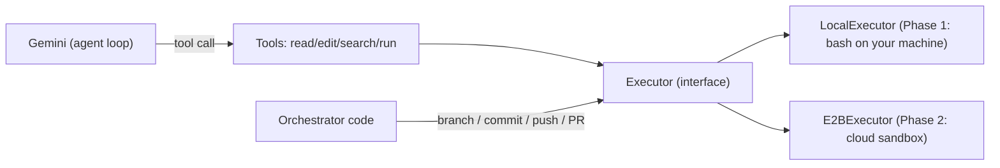

# Core Tools Plan (v2): Executor Abstraction + Agent Tools

> Status: **design doc only**. Nothing here has been applied to the codebase yet.

## 0. The big idea

The model should never know *where* its commands run. Tools talk to an **`Executor`**, and the executor decides whether that means "my laptop" or "an E2B cloud sandbox".



**Why:** in Phase 2 we only write one new class (`E2BExecutor`). Every tool, the agent loop, and all tests stay the same.

### Split of responsibilities

| Model gets (LLM tools) | Orchestrator does (plain Python, not a tool) |
| --- | --- |
| `read_file` (line ranges + line numbers) | clone repo, create task branch |
| `edit_file` (exact search-and-replace) | configure git identity |
| `write_file` (new files; overwrite opt-in) | final commit + push |
| `list_dir`, `search_code` | open PR via `pygithub` |
| `run_command` (bash, via executor) | iteration / time limits |
| `git_diff` (read-only review) | |

**Why git writes are not tools:** branch → commit → push → PR is the same every time. Code that's deterministic is testable and can't be "forgotten" or done wrong by the model. The model only needs to *see* its changes (`git_diff`), not manage history.

---

## 1. Folder layout

```text
apps/worker/
├── executor/
│   ├── __init__.py      # re-exports Executor, LocalExecutor, CommandResult, ...
│   ├── base.py          # the interface + shared data types
│   ├── local.py         # Phase 1: runs bash on this machine
│   └── e2b.py           # Phase 2: runs inside an E2B sandbox (sketch)
└── tools/
    ├── __init__.py      # build_tools(executor) -> list of callables for Gemini
    ├── _common.py       # truncation + error-handling helpers
    ├── filesystem.py    # read_file, write_file, edit_file, list_dir
    ├── search.py        # search_code
    ├── terminal.py      # run_command
    └── git.py           # git_diff (read-only)
```

---

## 2. `executor/base.py` — the contract

```python
from abc import ABC, abstractmethod
from dataclasses import dataclass


class PathOutsideWorkspaceError(ValueError):
    """Raised when a path resolves outside the repository root."""


@dataclass
class CommandResult:
    exit_code: int
    stdout: str
    stderr: str
    timed_out: bool = False


@dataclass
class DirEntry:
    name: str
    is_dir: bool


class Executor(ABC):
    """Everything the tools need from 'a machine with a repo on it'.

    All `path` arguments are relative to the repository root.
    Implementations MUST reject paths that escape the root.
    """

    @abstractmethod
    def resolve(self, path: str) -> str:
        """Return the absolute path inside the workspace, or raise PathOutsideWorkspaceError."""

    @abstractmethod
    def run(self, command: str, timeout: int = 60) -> CommandResult:
        """Run a bash command with the repo root as the working directory."""

    @abstractmethod
    def read_text(self, path: str) -> str:
        """Read a file exactly as stored (no newline translation). Raise FileNotFoundError if missing."""

    @abstractmethod
    def write_text(self, path: str, content: str) -> None:
        """Write a file exactly as given, creating parent directories."""

    @abstractmethod
    def exists(self, path: str) -> bool: ...

    @abstractmethod
    def list_dir(self, path: str) -> list[DirEntry]: ...
```

**Why these choices:**
- **Small interface (6 methods).** Anything bigger is more work to port to E2B. E2B natively supports exactly these: `commands.run`, `files.read/write/exists/list`.
- **Paths are relative to the repo root, and the executor enforces it.** The model never passes a `cwd` and can't reach `../../.env`. Confinement lives in one place instead of being repeated in every tool.
- **`CommandResult` is structured, not a string.** Tools decide how to format it for the model. The orchestrator can check `exit_code` directly.
- **Raw read/write (no newline translation).** Python's default text mode on Windows silently turns `\n` into `\r\n` on write. That would make every touched file show up as fully changed in the diff.

---

## 3. `executor/local.py` — Phase 1

```python
import os
import shutil
import subprocess
from pathlib import Path

from .base import CommandResult, DirEntry, Executor, PathOutsideWorkspaceError

# Never leak our own credentials into commands the model runs.
_SECRET_MARKERS = ("KEY", "TOKEN", "SECRET", "PASSWORD")


def _to_str(data: str | bytes | None) -> str:
    # On timeout, subprocess may hand back bytes even when encoding= is set.
    if data is None:
        return ""
    if isinstance(data, bytes):
        return data.decode("utf-8", errors="replace")
    return data


class LocalExecutor(Executor):
    def __init__(self, root: str, bash_path: str | None = None):
        self.root = Path(root).resolve()
        if not self.root.is_dir():
            raise ValueError(f"Workspace root does not exist: {self.root}")

        self.bash = bash_path or shutil.which("bash")
        if not self.bash:
            raise RuntimeError(
                "bash not found. On Windows install Git for Windows and pass "
                r"bash_path='C:\Program Files\Git\bin\bash.exe'."
            )

    # ---- paths -------------------------------------------------------------
    def _abs(self, path: str) -> Path:
        p = (self.root / path).resolve()          # resolve() also follows symlinks
        if not p.is_relative_to(self.root):
            raise PathOutsideWorkspaceError(f"'{path}' is outside the workspace")
        return p

    def resolve(self, path: str) -> str:
        return str(self._abs(path))

    # ---- commands ----------------------------------------------------------
    def run(self, command: str, timeout: int = 60) -> CommandResult:
        env = {k: v for k, v in os.environ.items()
               if not any(m in k.upper() for m in _SECRET_MARKERS)}
        env.update({
            "CI": "1",                   # many tools skip interactive prompts in CI
            "GIT_TERMINAL_PROMPT": "0",  # git fails instead of asking for credentials
            "PAGER": "cat",
            "GIT_PAGER": "cat",          # no `less` hanging on git diff/log
        })
        try:
            r = subprocess.run(
                [self.bash, "-c", command],
                cwd=self.root,
                env=env,
                stdin=subprocess.DEVNULL,  # input prompts fail instantly instead of hanging
                capture_output=True,
                encoding="utf-8",
                errors="replace",          # never crash on weird bytes
                timeout=timeout,
            )
            return CommandResult(r.returncode, r.stdout, r.stderr)
        except subprocess.TimeoutExpired as e:
            return CommandResult(-1, _to_str(e.stdout), _to_str(e.stderr), timed_out=True)

    # ---- files -------------------------------------------------------------
    def read_text(self, path: str) -> str:
        with open(self._abs(path), encoding="utf-8", errors="replace", newline="") as f:
            return f.read()

    def write_text(self, path: str, content: str) -> None:
        p = self._abs(path)
        p.parent.mkdir(parents=True, exist_ok=True)
        with open(p, "w", encoding="utf-8", newline="") as f:
            f.write(content)

    def exists(self, path: str) -> bool:
        return self._abs(path).exists()

    def list_dir(self, path: str) -> list[DirEntry]:
        return [DirEntry(e.name, e.is_dir()) for e in self._abs(path).iterdir()]
```

**Why:**
- **Explicit `bash -c` instead of `shell=True`.** On Windows `shell=True` means `cmd.exe`, but the model writes bash (`ls`, `grep`, `&&`, `$VAR`). Using the same shell locally and in E2B (Linux) means a command that works in Phase 1 also works in Phase 2.
- **Pass `bash_path` explicitly on Windows.** `shutil.which("bash")` can pick up WSL's `C:\Windows\System32\bash.exe`, which has a different filesystem view. Git Bash is the predictable choice. Add a `bash_path` field to `Settings` in `packages/common`.
- **`stdin=DEVNULL` + `CI=1` + `GIT_TERMINAL_PROMPT=0`.** Interactive prompts fail in milliseconds instead of burning the whole timeout.
- **Secrets are stripped from the env.** Defense in depth: even if the model runs `env`, it doesn't see your API keys.
- **Known limitation:** on timeout, `subprocess.run` kills `bash` but not always its grandchildren (e.g. a dev server). That's acceptable locally; E2B sandboxes are destroyed per task anyway.

---

## 4. `executor/e2b.py` — Phase 2 sketch

> [!NOTE]
> Written against the e2b v2 Python SDK. Verify class and exception names against the installed `e2b-code-interpreter` version before implementing.

```python
import posixpath

from e2b_code_interpreter import Sandbox
from e2b_code_interpreter import CommandExitException, FileType, NotFoundException, TimeoutException

from .base import CommandResult, DirEntry, Executor, PathOutsideWorkspaceError


class E2BExecutor(Executor):
    def __init__(self, sandbox: Sandbox, root: str = "/home/user/repo"):
        self.sandbox = sandbox
        self.root = root.rstrip("/")

    def resolve(self, path: str) -> str:
        p = posixpath.normpath(posixpath.join(self.root, path))
        if p != self.root and not p.startswith(self.root + "/"):
            raise PathOutsideWorkspaceError(f"'{path}' is outside the workspace")
        return p

    def run(self, command: str, timeout: int = 60) -> CommandResult:
        try:
            r = self.sandbox.commands.run(
                command, cwd=self.root, timeout=timeout,
                envs={"CI": "1", "GIT_TERMINAL_PROMPT": "0", "PAGER": "cat", "GIT_PAGER": "cat"},
            )
            return CommandResult(r.exit_code, r.stdout, r.stderr)
        except CommandExitException as e:   # e2b raises on non-zero exit codes
            return CommandResult(e.exit_code, e.stdout, e.stderr)
        except TimeoutException:
            return CommandResult(-1, "", "", timed_out=True)

    def read_text(self, path: str) -> str:
        try:
            return self.sandbox.files.read(self.resolve(path))
        except NotFoundException as e:
            raise FileNotFoundError(path) from e   # same error type as LocalExecutor

    def write_text(self, path: str, content: str) -> None:
        self.sandbox.files.write(self.resolve(path), content)

    def exists(self, path: str) -> bool:
        return self.sandbox.files.exists(self.resolve(path))

    def list_dir(self, path: str) -> list[DirEntry]:
        return [DirEntry(e.name, e.type == FileType.DIR)
                for e in self.sandbox.files.list(self.resolve(path))]
```

**Why:** e2b raises an exception for non-zero exit codes, while `subprocess` doesn't. The executor hides that difference so tools always get a `CommandResult`. Likewise `NotFoundException` is mapped to `FileNotFoundError`, so tool error handling is identical for both backends.

---

## 5. `tools/_common.py` — shared helpers

```python
import functools

from executor.base import CommandResult, PathOutsideWorkspaceError

HEAD_CHARS = 1_000
TAIL_CHARS = 3_000


def truncate(text: str, head: int = HEAD_CHARS, tail: int = TAIL_CHARS) -> str:
    """Keep the start (context) and the end (errors/summary) of long output."""
    if len(text) <= head + tail:
        return text
    omitted = len(text) - head - tail
    return f"{text[:head]}\n\n[... {omitted} characters truncated ...]\n\n{text[-tail:]}"


def format_result(r: CommandResult, timeout: int | None = None) -> str:
    parts = [f"Command timed out after {timeout}s (partial output below)."
             if r.timed_out else f"Exit code: {r.exit_code}"]
    if r.stdout.strip():
        parts.append("STDOUT:\n" + truncate(r.stdout.strip()))
    if r.stderr.strip():
        parts.append("STDERR:\n" + truncate(r.stderr.strip()))
    if len(parts) == 1:
        parts.append("(no output)")
    return "\n\n".join(parts)


def tool_errors(fn):
    """Turn exceptions into readable error strings so the agent loop never crashes
    and the model gets feedback it can act on."""
    @functools.wraps(fn)   # keeps name, docstring and signature for Gemini's schema
    def wrapper(*args, **kwargs):
        try:
            return fn(*args, **kwargs)
        except PathOutsideWorkspaceError as e:
            return f"Error: {e}. Use paths relative to the repository root."
        except FileNotFoundError:
            return "Error: file not found. Use list_dir or search_code to locate it."
        except Exception as e:
            return f"Error: {type(e).__name__}: {e}"
    return wrapper
```

**Why head + tail:** tail-only loses the beginning (which command, which file, setup info). Head-only loses the actual error. Keeping both is cheap and covers both cases.

---

## 6. The tools

### Binding tools to an executor (closures)

Gemini builds the function schema from the function's **signature and docstring**. If `executor` were a parameter, the model would see it and try to fill it in. So each module exposes a factory that *closes over* the executor and returns clean functions:

```python
def make_filesystem_tools(executor: Executor) -> list[Callable]:
    def read_file(path: str, ...) -> str: ...   # uses `executor` from the outer scope
    return [read_file, ...]
```

### 6.1 `tools/filesystem.py`

```python
from typing import Callable

from executor.base import Executor
from ._common import tool_errors

MAX_READ_LINES = 400
IGNORED_DIRS = {".git", "node_modules", ".venv", "__pycache__", "dist", "build"}
MAX_DIR_ENTRIES = 200


def make_filesystem_tools(executor: Executor) -> list[Callable]:

    @tool_errors
    def read_file(path: str, start_line: int = 1, end_line: int = 0) -> str:
        """Read a text file with line numbers.

        Line numbers are shown as '   12| ' prefixes and are NOT part of the file content.
        Large files are returned in chunks; call again with a later start_line to continue.

        Args:
            path: File path relative to the repository root.
            start_line: First line to show (1-based). Defaults to 1.
            end_line: Last line to show (inclusive). 0 means 'until the chunk limit'.
        """
        lines = executor.read_text(path).splitlines()
        total = len(lines)
        if total == 0:
            return f"{path} is empty."

        start = max(start_line, 1)
        if start > total:
            return f"Error: start_line {start} is past the end of the file ({total} lines)."
        end = total if end_line <= 0 else min(end_line, total)
        end = min(end, start + MAX_READ_LINES - 1)

        body = "\n".join(f"{i:>5}| {lines[i - 1]}" for i in range(start, end + 1))
        header = f"{path} (lines {start}-{end} of {total})"
        footer = f"\n[{total - end} more lines; call read_file with start_line={end + 1}]" if end < total else ""
        return f"{header}\n{body}{footer}"

    @tool_errors
    def edit_file(path: str, old_str: str, new_str: str) -> str:
        """Edit a file by replacing one exact occurrence of old_str with new_str.

        old_str must match the file content exactly (including indentation) and must be unique.
        Include a few surrounding lines to make it unique. Do not include line-number prefixes.

        Args:
            path: File path relative to the repository root.
            old_str: Exact existing text to replace.
            new_str: Replacement text.
        """
        raw = executor.read_text(path)
        uses_crlf = "\r\n" in raw
        text = raw.replace("\r\n", "\n")          # model always writes '\n'
        old, new = old_str.replace("\r\n", "\n"), new_str.replace("\r\n", "\n")

        count = text.count(old)
        if count == 0:
            return "Error: old_str not found. Re-read the file and copy the text exactly."
        if count > 1:
            return f"Error: old_str matches {count} places. Add more surrounding lines to make it unique."

        updated = text.replace(old, new, 1)
        if uses_crlf:
            updated = updated.replace("\n", "\r\n")  # keep the file's original line endings
        executor.write_text(path, updated)
        return f"Edited {path}: replaced 1 occurrence."

    @tool_errors
    def write_file(path: str, content: str, overwrite: bool = False) -> str:
        """Create a new file. Prefer edit_file for changing existing files.

        Args:
            path: File path relative to the repository root.
            content: Full file content.
            overwrite: Set true only to deliberately replace an entire existing file.
        """
        if executor.exists(path) and not overwrite:
            return f"Error: {path} already exists. Use edit_file, or pass overwrite=true to replace it entirely."
        executor.write_text(path, content)
        return f"Wrote {len(content)} characters to {path}."

    @tool_errors
    def list_dir(path: str = ".") -> str:
        """List files and folders in a directory (folders end with '/').

        Args:
            path: Directory relative to the repository root. Defaults to the root.
        """
        entries = [e for e in executor.list_dir(path) if e.name not in IGNORED_DIRS]
        entries.sort(key=lambda e: (not e.is_dir, e.name.lower()))   # folders first
        lines = [e.name + ("/" if e.is_dir else "") for e in entries[:MAX_DIR_ENTRIES]]
        if len(entries) > MAX_DIR_ENTRIES:
            lines.append(f"[... {len(entries) - MAX_DIR_ENTRIES} more entries]")
        return "\n".join(lines) or "(empty directory)"

    return [read_file, edit_file, write_file, list_dir]
```

**Why:**
- **`edit_file` with a uniqueness check** is the main upgrade. Rewriting whole files is slow, uses a lot of tokens, and models often drop lines by accident. An exact-match replace either does exactly what was intended or fails with a message the model can act on.
- **CRLF handling:** your local files on Windows may use `\r\n` while the model writes `\n`. Without normalising, `old_str` would never match. Restoring the original endings keeps diffs clean.
- **Line numbers + chunking in `read_file`** let the model talk about specific lines and read big files in pieces without blowing up the context.
- **`write_file` refuses to overwrite by default**, which pushes the model toward `edit_file` while still allowing a deliberate full rewrite.

### 6.2 `tools/search.py`

```python
import shlex
from typing import Callable

from executor.base import Executor
from ._common import tool_errors, truncate

MAX_MATCHES = 100
EXCLUDE = [".git", "node_modules", ".venv", "__pycache__", "dist", "build"]


def make_search_tools(executor: Executor) -> list[Callable]:

    @tool_errors
    def search_code(pattern: str, path: str = ".", file_glob: str = "") -> str:
        """Search file contents with a regular expression (grep -E). Returns 'file:line:text' matches.

        Args:
            pattern: Extended regular expression, e.g. 'def build_tools' or 'TODO|FIXME'.
            path: Directory or file to search, relative to the repository root.
            file_glob: Optional filename filter, e.g. '*.py'.
        """
        executor.resolve(path)   # raises if path escapes the workspace

        args = ["grep", "-rnIE", "--color=never"] + [f"--exclude-dir={d}" for d in EXCLUDE]
        if file_glob:
            args.append(f"--include={file_glob}")
        args += ["--", pattern, path]
        cmd = " ".join(shlex.quote(a) for a in args) + f" | head -n {MAX_MATCHES + 1}"

        r = executor.run(cmd, timeout=30)
        if r.stderr.strip():
            return f"Search error: {r.stderr.strip()}"
        lines = r.stdout.splitlines()
        if not lines:
            return f"No matches for '{pattern}'."
        if len(lines) > MAX_MATCHES:
            lines = lines[:MAX_MATCHES] + [f"[more than {MAX_MATCHES} matches; narrow the pattern or path]"]
        return truncate("\n".join(lines))

    return [search_code]
```

**Why:**
- **`grep` over `ripgrep`:** grep is guaranteed in Git Bash and in the default E2B image. Switching to `rg` later is a one-line change.
- **`shlex.quote` on every argument:** the model's pattern can contain `|`, `$`, quotes and so on. Quoting stops it from being interpreted as shell syntax.
- **`| head -n`:** caps output at the source so a search for `e` doesn't stream megabytes back.

### 6.3 `tools/terminal.py`

```python
from typing import Callable

from executor.base import Executor
from ._common import format_result, tool_errors

DEFAULT_TIMEOUT = 60
MAX_TIMEOUT = 300


def make_terminal_tools(executor: Executor) -> list[Callable]:

    @tool_errors
    def run_command(command: str, timeout: int = DEFAULT_TIMEOUT) -> str:
        """Run a bash command in the repository root (e.g. run tests, install deps, build).

        Commands are non-interactive: anything waiting for keyboard input fails immediately.
        Do not start long-running servers or watchers.

        Args:
            command: Bash command to execute.
            timeout: Seconds before the command is killed (max 300). Defaults to 60.
        """
        timeout = max(1, min(timeout, MAX_TIMEOUT))   # the model can't request an hour
        return format_result(executor.run(command, timeout=timeout), timeout=timeout)

    return [run_command]
```

**Why:**
- **Clamped timeout:** the model may ask for a longer timeout for slow test suites, but within a hard cap.
- **The docstring tells the model the rules** (non-interactive, no servers). Models follow tool descriptions well, so this prevents a whole class of hangs before they happen.

### 6.4 `tools/git.py` (read-only)

```python
from typing import Callable

from executor.base import Executor
from ._common import format_result, tool_errors, truncate


def make_git_tools(executor: Executor) -> list[Callable]:

    @tool_errors
    def git_diff() -> str:
        """Show all changes made so far: changed/untracked files plus the full diff against HEAD.
        Use this to review your work before finishing."""
        status = executor.run("git --no-pager status --short", timeout=30)
        if status.exit_code != 0:
            return format_result(status)
        if not status.stdout.strip():
            return "No changes."

        diff = executor.run("git --no-pager diff HEAD", timeout=30)
        return (
            f"Changed files ('??' = untracked, read them with read_file):\n{status.stdout.strip()}"
            f"\n\nDiff:\n{truncate(diff.stdout.strip()) or '(only untracked files)'}"
        )

    return [git_diff]
```

**Why one tool and no parameters:** `git diff HEAD` covers both staged and unstaged changes. The model doesn't stage anything anyway (the orchestrator commits), so a `staged` flag would just be noise.

### 6.5 `tools/__init__.py`

```python
from typing import Callable

from executor.base import Executor
from .filesystem import make_filesystem_tools
from .git import make_git_tools
from .search import make_search_tools
from .terminal import make_terminal_tools


def build_tools(executor: Executor) -> list[Callable]:
    """All agent tools bound to one executor (one repo / one sandbox / one task)."""
    return [
        *make_filesystem_tools(executor),
        *make_search_tools(executor),
        *make_terminal_tools(executor),
        *make_git_tools(executor),
    ]
```

This replaces the current module-level `AGENT_TOOLS` list. Tools must be built **per task**, because each task has its own repo/sandbox.

---

## 7. Orchestrator git workflow (Phase 3 preview, not tools)

```python
import shlex

from executor.base import Executor


def prepare_branch(executor: Executor, branch: str) -> None:
    executor.run('git config user.name "cloud-coding-agent"')
    executor.run('git config user.email "agent@users.noreply.github.com"')
    r = executor.run(f"git checkout -b {shlex.quote(branch)}")
    if r.exit_code != 0:
        raise RuntimeError(f"Could not create branch: {r.stderr}")


def commit_all(executor: Executor, message: str) -> bool:
    """Returns False if there was nothing to commit."""
    executor.run("git add -A")
    if executor.run("git diff --cached --quiet").exit_code == 0:
        return False                      # nothing staged; not an error
    r = executor.run(f"git commit -m {shlex.quote(message)}")
    if r.exit_code != 0:
        raise RuntimeError(f"Commit failed: {r.stderr}")
    return True
```

**Why:** this fixes both `git_commit` bugs from v1. The identity is set up front (fresh sandboxes don't have one), and "nothing to commit" is detected cleanly instead of being reported as a failure.

---

## 8. How the agent loop will use this

```python
from google import genai
from google.genai import types

from common.core.config import Settings
from executor import LocalExecutor
from tools import build_tools

settings = Settings()
executor = LocalExecutor(root=r"C:\path\to\a\test-repo", bash_path=settings.bash_path)

client = genai.Client(api_key=settings.gemini_api_key)
chat = client.chats.create(
    model=MODEL_NAME,
    config=types.GenerateContentConfig(
        tools=build_tools(executor),
        system_instruction=SYSTEM_PROMPT,
    ),
)
```

> [!IMPORTANT]
> Point `LocalExecutor` at a **throwaway test repo**, never at this project itself, until the E2B sandbox is in place.

---

## 9. Implementation order and checks

1. **`executor/base.py` + `executor/local.py`.** Check: `run("echo hi")`, `run("sleep 5", timeout=1)` → `timed_out`, `run("read x")` → returns instantly, `resolve("../x")` → raises.
2. **`tools/_common.py`.** Check: `truncate` on a 10k-char string keeps head and tail.
3. **`tools/filesystem.py`.** Check: `edit_file` with 0 / 1 / 2 matches, edit on a CRLF file keeps CRLF, `read_file` chunking on a 1000-line file.
4. **`tools/search.py`, `terminal.py`, `git.py`.** Check against the test repo.
5. **`tools/__init__.py`.** Check that Gemini sees clean schemas (no `executor` parameter, docstrings intact, `@tool_errors` doesn't hide the signature), e.g. by inspecting `types.FunctionDeclaration.from_callable(...)` for each tool.
6. **Agent loop** (next doc).
7. **Phase 2:** `executor/e2b.py`, then re-run the same checks with `E2BExecutor`.

### Config changes needed
- Add `bash_path: str | None = None` to `Settings` in `packages/common/src/common/core/config.py`.
- Add `bash_path=C:\Program Files\Git\bin\bash.exe` to `.env`.
